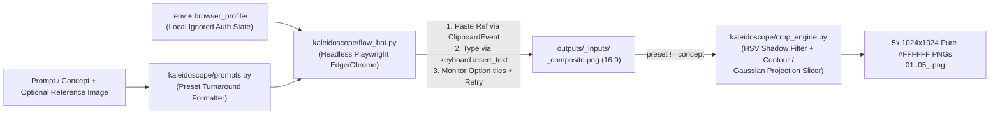

# KaleidoscopeV2

**Headless Google Flow Automation & Computer-Vision 5-in-1 Consistent Turnaround Synthesis Engine**

`KaleidoscopeV2` automates generating visually consistent multi-view 3D reference sheets (or widescreen environment concept art) through **Google Flow** using a headless Playwright browser with persistent authentication, paired with a hybrid OpenCV/NumPy **5-in-1 orthographic slicer** that splits wide `16:9` composite turnaround sheets into five centered, aspect-preserved **`1024x1024` pure-white (`#FFFFFF`) PNG** references ready for 3D reconstruction tools (Rodin, Tripo, Meshy, Blender, Roblox Studio).

---

## Architecture Overview



### Why `KaleidoscopeV2` Works Reliably on Google Flow
Standard Playwright scripts often fail silently on Google Flow because Flow uses a rich **ProseMirror (`contenteditable`)** composer protected by Trusted Types and dynamic consent dialogs. `FlowHeadlessBot` implements the exact browser-level patterns proven in production:
1. **Persistent Auth Context (`browser_profile/`)**: Sign in interactively once with `kaleidoscope auth`; cookies and tokens persist across subsequent `headless=True` runs.
2. **ProseMirror-Safe Clipboard Paste**: Attaches `--ref-image` files by injecting a base64 `File` into a synthetic `ClipboardEvent('paste', { clipboardData: DataTransfer })` directly on `.ProseMirror` (falling back to the *"Add ingredients -> Upload media"* file chooser if needed) and automatically dismissing *"I agree"* upload modals.
3. **Trusted-Types-Safe Prompt Insertion**: Uses `page.keyboard.insert_text(...)` rather than DOM `.value` / `.fill()` mutation so multi-hundred-character turnaround specifications always register cleanly in React/ProseMirror state.
4. **Fresh Session & Option Delta Detection**: Optionally resets chat context via `New session`, counts pre-existing `img[alt^='Option']` tiles, auto-clicks transient `Try again` buttons, and downloads full-resolution generated images via authenticated `page.request.get(src)`.
5. **Hybrid 5-in-1 Slicing & Shadow Filtering**: Uses corner-sampled adaptive thresholding + HSV neutral floor-shadow filtering, merges vertically disjoint fragments in the same column, isolates 5 horizontal views via connected contours (with automatic fallback to Gaussian-smoothed vertical projection valleys), and centers each cropped angle onto a sharp `1024x1024` pure `#FFFFFF` LANCZOS canvas.

---

## Project Layout

```text
KaleidoscopeV2/
├── kaleidoscope/
│   ├── __init__.py          # Public Python API exports
│   ├── config.py            # Safe `.env` & environment variable loader
│   ├── prompts.py           # Character, Weapon, Prop (Top/Bottom), & Concept presets
│   ├── setup_session.py     # Interactive login & `--check` headless session verifier
│   ├── flow_bot.py          # Persistent Playwright Flow automation client
│   ├── crop_engine.py       # Hybrid HSV contour + projection 5-view slicer
│   └── cli.py               # Unified CLI (`auth`, `generate`, `slice`, `batch`, `inspect`)
├── examples/
│   ├── batch_example.json   # Multi-asset batch task list
│   └── run_batch_example.py # Programmatic Python API usage example
├── tests/
│   └── test_crop_engine.py  # Offline verification tests
├── AGENTS.md                # AI Agent Operating Manual (for workspace handoff)
├── CLAUDE.md                # Claude Code quickstart guide
├── SKILL.md                 # Portable Agent Skill definition
├── .env.example             # Safe configuration template
├── .gitignore               # Blocks `.env`, `browser_profile/`, and generated outputs
├── pyproject.toml
└── requirements.txt
```

---

## Quick Start

### 1. Install Dependencies

```bash
git clone https://github.com/Ahauyy/KaleidoscopeV2.git
cd KaleidoscopeV2

python -m venv .venv
# Windows PowerShell:
.venv\Scripts\Activate.ps1
# macOS / Linux:
# source .venv/bin/activate

pip install -r requirements.txt
pip install -e .
```

If you want Playwright to use its bundled Chromium instead of Microsoft Edge/Chrome, also install the browser binary:
```bash
playwright install chromium
```

### 2. Configure `.env` Safely (Do Not Commit!)

Copy `.env.example` to `.env`:
```bash
# Windows PowerShell
copy .env.example .env

# macOS / Linux
cp .env.example .env
```

Edit `.env` to match your browser and workspace:
- `FLOW_PROJECT_URL`: Default `https://flow.google.com/` (or paste a dedicated Flow project URL after creating one in your browser).
- `KALEIDOSCOPE_BROWSER_CHANNEL`: `msedge` (Windows default), `chrome`, or `chromium`.
- `KALEIDOSCOPE_PROFILE_DIR`: `./browser_profile` (stores local login cookies; strictly ignored by Git).

> **Security Warning:** Never remove `.env` or `browser_profile/` from `.gitignore`, never paste cookies/project URLs into tracked code files, and run `git status` before pushing forks or contributions.

### 3. One-Time Interactive Authentication

Sign into Google Flow once in a visible browser window:
```bash
python -m kaleidoscope.cli auth
```
Complete your Google sign-in, optionally open/create your Flow project, and return to the terminal to press `Enter`.

Verify headless session health anytime without opening a window:
```bash
python -m kaleidoscope.cli auth --check
```

---

## Usage Guide (CLI)

### Generate a 5-View Turnaround + Auto-Slice (`1024x1024`)

**Character Turnaround (`character` preset):**
```bash
kaleidoscope generate \
  --name cyber_knight \
  --preset character \
  --prompt "armored cyberpunk knight in sleek white and titanium tactical plating with cyan visor" \
  --ref-image ./path/to/concept.png
```

**Weapon Turnaround with Top-Down Cross-Section (`weapon` preset):**
```bash
kaleidoscope generate \
  --name neon_hammer \
  --preset weapon \
  --prompt "industrial warhammer with twin glowing magenta aerosol canisters and dark steel grip" \
  --ref-image ./path/to/weapon_ref.png
```

**Flat Prop with Top + Bottom Artwork (`prop_topbottom` preset):**
```bash
kaleidoscope generate \
  --name graffiti_skate \
  --preset prop_topbottom \
  --prompt "cyberpunk skateboard with neon skull crown on bottom deck and dense graffiti tags on grip tape" \
  --ref-image ./path/to/skate_ref.png
```

**Single 16:9 Concept Art without Slicing (`concept` preset):**
```bash
kaleidoscope generate \
  --name valley_castle \
  --preset concept \
  --prompt "medieval stone citadel above a turquoise canyon river and terracotta village"
```

### Run Batch Generation in One Browser Session
```bash
kaleidoscope batch --config examples/batch_example.json
```

### Slice an Existing Composite Turnaround Sheet Offline
```bash
kaleidoscope slice \
  --input ./raw_turnaround_16_9.png \
  --output-dir ./outputs/my_asset_inputs \
  --prefix my_asset \
  --preset character \
  --mode auto
```

### Offline Smoke Test (No Google Account Needed)
Verify slicing and pipeline orchestration offline using a synthetic 16:9 composite:
```bash
python -m unittest discover -s tests -v
kaleidoscope generate --name mock_smoke --prompt "test mech hero" --mock
```

### Debug DOM Selectors (`inspect`)
If Google Flow changes UI labels in the future, run headed inspection:
```bash
kaleidoscope inspect --headed
```

---

## Preset Output Filenames

| Preset | `01` | `02` | `03` | `04` | `05` |
| :--- | :--- | :--- | :--- | :--- | :--- |
| `character` | `01_front_view` | `02_three_quarter_front` | `03_side_profile` | `04_three_quarter_back` | `05_back_view` |
| `weapon` | `01_front_view` | `02_back_view` | `03_right_view` | `04_top_view` | `05_perspective` |
| `prop_topbottom` | `01_top_view` | `02_three_quarter_top` | `03_side_profile` | `04_three_quarter_bottom` | `05_bottom_view` |
| `concept` | *(not sliced — saves full `<name>_composite.png` only)* | — | — | — | — |

All sliced turnaround outputs are saved under `outputs/<name>_inputs/` at `1024x1024` RGB PNG on `#FFFFFF`.

---

## AI Agent Integration (Multi-Workspace Ready)

If you drop `KaleidoscopeV2` into any workspace with an AI coding assistant (Antigravity, Claude Code, Cursor, Codex):
- Tell the AI to read [`AGENTS.md`](AGENTS.md), [`CLAUDE.md`](CLAUDE.md), or load [`SKILL.md`](SKILL.md).
- The agent will automatically know how to check session health (`auth --check`), prompt the user if interactive login is needed, select the proper preset/reference flags, run batch jobs, inspect the 5 output views visually, and avoid leaking `.env` or `browser_profile/`.
